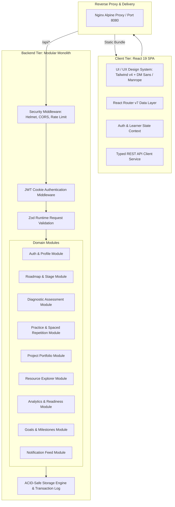
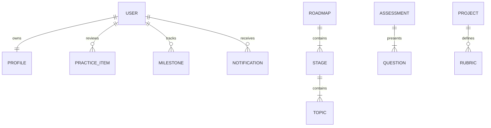

# SkillPath AI — System Architecture & Engineering Specifications

## 1. Overview
SkillPath AI is an adaptive, evidence-based career learning roadmap platform. Unlike static learning portals or video catalogs, SkillPath calibrates personalized learning journeys around:
- **Baseline Diagnostic Assessments**: Measuring actual understanding to identify gaps and avoid redundant instruction.
- **Dynamic Roadmaps**: Structured stages and topics that adapt based on mastery signals.
- **Active Recall & Spaced Repetition**: Memory retention algorithms tracking decay curves.
- **Portfolio-Grade Project Rubrics**: Evaluated evidence of competence.

---

## 2. System Architecture

---

## 3. Data Model & Entity Relationships

### Core Entities:
1. **User**: Authentication credentials (`email`, `passwordHash` using bcrypt), roles (`learner`, `admin`, `mentor`).
2. **LearnerProfile**: Personalization traits, time budget (`hours/week`), learning style, verified diagnostic score, streak calendar, and readiness metric.
3. **Roadmap & Stages**: Ordered learning phases with durations, progress calculations, and prerequisites.
4. **Topics**: Modular curriculum units with video walkthrough metadata, concepts, code snippets, and completion states.
5. **Diagnostic Assessment**: Questions with topic tags, randomized option orders, and explanation payloads.
6. **Practice Item**: Spaced repetition tracking with memory decay score and review timestamps.
7. **Projects**: Rubric-based portfolio briefs with submission links and evaluation states.
8. **Resources**: Curated multi-format learning items (videos, documentation, interactive tools) with bookmarking.
9. **Goals & Milestones**: Time-bound checkpoints with percentage tracking.

---

## 4. Security Threat Model & Mitigations (OWASP)

| Threat Category | Potential Attack Vector | Applied Engineering Mitigation |
|---|---|---|
| **Injection** | SQL / NoSQL / Command Injection | Strict Zod input schema validation, parameterized queries, and type safety across all endpoints. |
| **Broken Authentication** | Credential stuffing, brute-force | Rate limiting on authentication routes (`express-rate-limit`), bcrypt password hashing (10 salt rounds), generic authentication error responses to prevent account enumeration. |
| **Sensitive Data Exposure** | Stack traces or leaked secrets | Redaction filters in structured logger (`[REDACTED]` for passwords, tokens, cookies), sanitized operational error handlers. |
| **Broken Access Control** | IDOR, unauthorized privilege escalation | Server-side `requireAuth` and `requireRole` middleware; client tokens validated with HMAC SHA-256 JWT signatures. |
| **Cross-Site Scripting (XSS)** | Malicious scripts in user inputs | HTTP-Only, Secure, SameSite cookies for tokens; Helmet Content Security Policy (CSP); React automatic output escaping. |
| **Cross-Origin Resource Sharing** | Malicious origins accessing APIs | Explicit origin whitelisting in CORS middleware. |

---

## 5. Observability & Reliability
- **Correlation IDs**: Every inbound request receives an `x-correlation-id` header generated or propagated through `requestLogger`.
- **Structured JSON Logging**: Standard JSON log lines with timestamps, status codes, latency in milliseconds, and IP.
- **Health Probes**:
  - `/health`: Liveness probe indicating process health and uptime.
  - `/health/ready`: Readiness probe verifying storage readiness.
- **Graceful Shutdown**: Traps `SIGTERM` and `SIGINT` to flush pending disk writes and close active connections cleanly.
